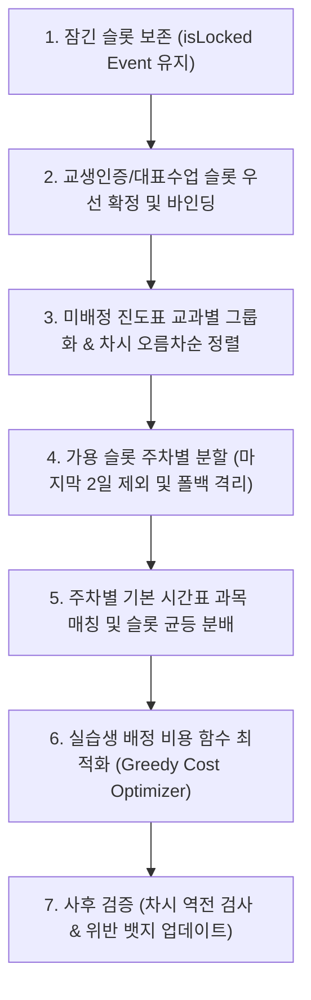

# 🤖 AGENTS.md — 교생 수업 배당표 자동 완성 시스템

> **대상**: 이 저장소(Codebase)를 분석, 유지보수, 기능 추가 및 리팩토링하는 모든 AI 코딩 에이전트(Antigravity, Claude Code, GitHub Copilot, Cursor 등) 및 개발자  
> **핵심 원칙**: **하네스 엔지니어링(Harness Engineering)** 기반의 엄격한 제약조건 준수, **31대 벤치마크 테스트 100% 무결성 유지(31/31 PASS)**, 무설치 클라이언트 완결형 단일 SPA 구조 보존

---

## 1. 🧭 프로젝트 비전 및 도메인 개요 (Project Overview)

본 시스템은 **공주교육대학교부설초등학교(공주교대부초)**를 비롯한 전국 초등학교의 교육실습 현장에서 **실습생(교생)의 수업 배당표를 하네스 엔지니어링 최적화 솔버로 100% 자동 완성하고 관리하는 웹 애플리케이션**입니다.

### 도메인 특수성 및 해결 과제
1. **차시 순서성 엄수 (Sequence Integrity)**: 국어, 수학 등 초등 교육과정은 앞 차시를 배우지 않고 뒤 차시를 먼저 배울 수 없습니다. 동일 교과의 차시는 시간 흐름에 따라 **100% 오름차순**으로 배치되어야 합니다. 단 바른생활(바생), 슬기로운생활(슬생), 즐거운생활(즐생) 등의 통합교과는 예외로 둡니다. 
2. **잠긴 행사 및 불가 시간 보호 (Hard-Lock Invariant)**: 교장/수석교사 강의, 전교생 참관 수업, 학급 협의회, 공휴일(개교기념일, 노동절 등)은 절대 일반 수업이 침범할 수 없습니다.
3. **실습생 시수 공평성 (Fairness)**: 모든 실습생의 총 수업 시수 편차는 **최대 1시간 이내(동일 목표 시 골든 0시간)**로 정밀하게 균등 분배되어야 합니다.
4. **교과 다양성 및 쿼터 보장 (Diversity & Quota)**: 특정 교생에게 특정 교과(예: 예체능)만 몰리지 않도록 인문·수리·예체능·생활 전 영역을 고루 경험하게 하거나, 교생별 맞춤 목표 쿼터(`국(2) 도(1) 수(1)...`)를 정확히 만족해야 합니다.
5. **실습 마지막 2일 수업 배제 원칙**: 종합/수업 실습 마지막 2일(목, 금)은 소감문 작성, 설문, 끝인사, 총평회 위주이므로 일반 수업 배정을 지양하고 예비 슬롯으로만 관리합니다.
6. **학교 현장 연동성**: 아래아한글(HWP) 빈 문서에 `Ctrl+V`로 즉시 표가 생성되는 기능, 공주교대부초 표준 양식의 엑셀(.xlsx) 내보내기, 단톡방용 지도안 마감일 달력(D-3, D-1) 및 고화질 PNG 렌더링을 제공합니다.

---

## 2. 🏗️ 기술 스택 및 아키텍처 원칙 (Tech Stack & Architecture)

### 2.1 프론트엔드 (Client-Side SPA)
- **런타임 환경**: Node.js 빌드나 웹팩/비트 번들링 없이 **[`index.html`](file:///c:/Users/user/Documents/GitHub/student-teacher-timetable/index.html) 단일 파일 더블클릭**으로 구동되는 독립형 웹 애플리케이션입니다.
- **스타일링**: [Tailwind CSS (CDN)](https://cdn.tailwindcss.com) + [Pretendard 웹폰트](https://cdn.jsdelivr.net/gh/orioncactus/pretendard/dist/web/static/pretendard.css)
- **아이콘**: [Lucide Icons (CDN)](https://unpkg.com/lucide@latest)
  - ⚠️ **주의**: 동적으로 DOM을 렌더링하거나 탭을 전환한 후에는 반드시 `lucide.createIcons()`를 호출해야 새 아이콘이 정상 렌더링됩니다.
- **엑셀 엔진**: [ExcelJS v4.4.0](https://cdn.jsdelivr.net/npm/exceljs@4.4.0/dist/exceljs.min.js) + [FileSaver v2.0.5](https://cdn.jsdelivr.net/npm/file-saver@2.0.5/dist/FileSaver.min.js)
  - 브라우저 메모리 상에서 워크북과 2개 워크시트([수업배당표], [교생별지도안마감일달력])를 네이티브 서식(배경색, 테두리, 폰트, 열 너비, 인쇄 여백)으로 빌드하여 `.xlsx` 다운로드.
- **이미지 렌더링**: [html2canvas v1.4.1](https://cdn.jsdelivr.net/npm/html2canvas@1.4.1/dist/html2canvas.min.js) (2배율 고해상도 PNG 스크린샷)
- **데이터 시각화**: [Chart.js v4.4.1](https://cdn.jsdelivr.net/npm/chart.js@4.4.1/dist/chart.umd.min.js) (레이더 차트 & 바 차트)

### 2.2 보조 파이프라인 및 백엔드 스크립트 (Python 3.14)
- **브라우저 자동화 & 무인 검증**: Microsoft Edge Headless + Chrome DevTools Protocol(CDP) 소켓 통신을 이용해 UI를 띄우지 않고 벤치마크 테스트를 자동 실행([`check_test_results.py`](file:///c:/Users/user/Documents/GitHub/student-teacher-timetable/check_test_results.py)).
- **교육과정 데이터셋 정제 파서**: CSV, XLSX 원본 데이터를 분석하여 정규화된 JSON 데이터베이스로 변환하는 스크립트군 (`parse_grade3_data.py`, `parse_grade5.py` 등).
- **지도안 서식 사양화**: HWPX/PDF 23개 대표수업 과정안을 분석하여 표준 세안/본시안 명세화 ([`lesson_plan_format_specification.json`](file:///c:/Users/user/Documents/GitHub/student-teacher-timetable/lesson_plan_format_specification.json)).

---

## 3. 📂 디렉터리 및 주요 파일 역할 (Repository Structure)

```
c:/Users/user/Documents/GitHub/student-teacher-timetable/
├── AGENTS.md                            # [본 문서] AI 에이전트 및 개발자를 위한 전방위 아키텍처 및 작업 가이드
├── README.md                            # 사용자 안내 매뉴얼 및 릴리즈 노트
├── index.html                           # [핵심] 7,200+ 라인의 단일 완결형 SPA 메인 웹 애플리케이션
├── test_runner.html                     # [테스트 하네스] index.html을 iframe으로 구동하여 21개 시나리오를 검증하는 테스트 러너
├── test_script.js                       # 테스트 전용 모듈 및 데이터베이스 백업 스크립트
│
├── curriculum_db_grade2.json / .csv     # 2학년 1·2학기 교과 진도표 표준 데이터베이스 (총 745차시)
├── grade3_parsed.json                   # 3학년 2학기 9개 전 교과 진도표 표준 데이터베이스 (총 423차시)
├── grade5_curriculum_db.json            # 5학년 2학기 10개 전 교과 진도표 표준 데이터베이스 (총 452차시)
│
├── lesson_plan_format_specification.json # 공주교대부초 2026학년도 지도안 표준 규격 사양서 (본시안/세안)
├── template_se_an_extracted.txt         # 2022 개정 교육과정 지도안 세안 HWP 텍스트 추출본
├── extracted_lesson_plans_data.json     # 23개 대표수업 지도안 전수 분석 데이터셋
│
├── check_test_results.py                # Headless Edge 브라우저를 띄워 test_runner.html의 결과를 반환하는 자동 검증기
├── run_wait_benchmark.py                # CDP 기반 벤치마크 및 타이머 모니터링 스크립트
├── verify_and_capture.py                # 스크린샷 캡처 및 화면 무결성 검증 도구
├── take_screenshots.py                  # 주요 단계별 화면 캡처 유틸리티
│
├── parse_grade3_data.py                 # 3학년 원시 데이터(영어 등) 파싱 스크립트
├── parse_grade5.py                      # 5학년 엑셀 교육과정 데이터셋 정제 스크립트
├── update_curriculum_db.py              # 2학년 통합교과(바·슬·즐) 진도표 업데이트 스크립트
├── update_grade3_math_art.py            # 3학년 수학·미술 진도표 갱신 스크립트
└── update_grade3_music.py               # 3학년 음악 진도표 갱신 스크립트
```

---

## 4. ⚙️ 핵심 데이터 모델 규격 (`App` State)

모든 상태는 [`index.html`](file:///c:/Users/user/Documents/GitHub/student-teacher-timetable/index.html) 내 전역 `App` 객체에서 일원 관리됩니다.

### 4.1 기본 설정 (`App.config`)
```javascript
{
  title: "교육실습IV(종합) 교육 실습생 수업배당표(0학년)",
  school: "공주교육대학교부설초등학교",
  gradeClass: "0학년 0반",
  teacherName: "김지도",
  weekCount: 2,         // 1 ~ 4주차 (총 일수 = weekCount * 5)
  startDate: "2026-04-20", // 실습 시작 월요일 (YYYY-MM-DD)
  maxHours: 10,         // 1인당 최대 상한 시수
  periodsPerDay: 8,     // 1일 수업 교시 수 (6 ~ 8교시 동적 대응)
  notes: "..."          // 하단 비고란 텍스트
}
```

### 4.2 실습생 목록 (`App.teachers`)
```javascript
[
  {
    id: "t1",
    name: "김부설",
    major: "국어",            // 심화 전공
    certSubject: "국어",      // 교생인증수업 과목 (🏅)
    demoSubject: "국어",      // 교생대표수업 과목 (⭐)
    note: "국(2) 도(1) 사(1) 수(1)...", // 교과 쿼터 텍스트 표현
    subjectHours: { "국어": 2, "도덕": 1, "사회": 1, ... }, // 파싱된 쿼터 객체
    colorIdx: 0               // TEACHER_COLORS 테마 인덱스 (0~9)
  }
]
```

### 4.3 교과 진도표 (`App.curriculum`)
```javascript
[
  {
    id: "c1",
    subject: "국어",
    pages: "118-120",
    lesson: "3",              // 단일 차시 또는 압축 차시("3~4", "5-6")
    totalLesson: 15,          // 전체 단원 차시
    topic: "시의 분위기 살펴보기",
    isCert: false,            // 인증수업 여부 (🏅)
    isDemo: false,            // 대표수업 여부 (⭐)
    designatedTeacher: "",    // 사전 지정 실습생 이름 (없으면 자동 배정)
    demoTeacher: "",          // 대표수업 교생 이름
    isBlock: false            // 연강 블록 여부
  }
]
```

### 4.4 행사 & 불가 시간표 (`App.events`)
- 키 형식: `"${dayIndex}-${period}"` (예: `0-1` = 1주차 월요일 1교시, `19-6` = 4주차 금요일 6교시)
```javascript
{
  "0-1": {
    type: "homeroom",         // 'lecture' | 'observation' | 'meeting' | 'design' | 'homeroom' | 'holiday' | 'trainee_cert' | 'trainee_demo' | 'custom'
    subject: "창체",
    pages: "학생과",
    lessonStr: "첫인사",
    teacher: "담임",
    isLocked: true            // true인 경우 솔버 및 일반 수업 배정 시 절대 침범 금지
  }
}
```

### 4.5 완성된 배당표 (`App.timetable`)
- 키 형식: `"${dayIndex}-${period}"`
```javascript
{
  "0-2": {
    subject: "국어",
    pages: "118-120",
    lesson: "3",
    totalLesson: 15,
    topic: "...",
    teacher: "김부설",
    isCert: false,
    isDemo: false,
    isLocked: false,
    curriculumId: "c1"
  }
}
```

---

## 5. 🧠 배당 최적화 솔버 알고리즘 (`runAutoAllocation`) 파이프라인

`App.runAutoAllocation(showAlert = true)` 메서드는 다음과 같은 엄밀한 6단계 파이프라인으로 동작합니다:



### 단계별 상세 로직
1. **잠긴 슬롯 보존**: `this.events[key].isLocked`인 셀을 그대로 복사하여 보존하고, 나머지 슬롯을 초기화합니다.
2. **인증/대표 수업 슬롯 우선 매칭**:
   - `trainee_cert`(🏅) 및 `trainee_demo`(⭐)로 지정된 슬롯에 대해 진도표 내 일치하는 과목/실습생 항목을 찾아 즉시 확정(`_consumed = true`)하고 실습생 시수 누적기에 반영합니다.
3. **진도표 과목별 큐 정렬**:
   - 남은 진도표 항목을 과목별로 분할한 뒤, `parseLessonNum(lesson)`을 기준으로 **오름차순 정렬**합니다.
   - 압축 차시(`3~4`, `5-6`)의 경우 시작 숫자(3, 5)를 정수로 파싱하여 정렬 순서를 유지합니다.
4. **가용 슬롯 분할 및 마지막 2일 격리**:
   - 주차별 슬롯(`slotsByWeek[w]`)으로 분할하되, 실습 전체 마지막 2일(`d >= totalDays - 2`)은 일반 슬롯 풀에서 제외하여 `fallbackSlots`로 격리합니다.
5. **주차별 슬롯 할당 (Smooth Weekly Distribution)**:
   - 각 과목별 총 차시 $K$를 주차 수 $W$로 나눈 기본 몫과 나머지를 주차별로 고르게 분산(`subjectWeeklyTarget[sub][w]`).
   - 기본 시간표(`defaultTimetable`)의 해당 교시 과목과 일치하는 슬롯을 1순위로 우선 매칭하고, 남은 슬롯을 같은 주차 내에서 채웁니다.
   - 각 과목에 배정된 슬롯들을 시간순(`day`, `period`)으로 정렬하고, 오름차순 정렬된 진도표 항목과 1:1로 결합하여 **차시 순서성을 100% 보장**합니다.
6. **실습생 배정 비용 함수 (Cost Function Optimizer)**:
   - 사전 지정 실습생(`designatedTeacher` 또는 `demoTeacher`)이 있으면 최우선 배정.
   - 미지정 셀에 대해 후보 실습생별 페널티 비용 계산:
     - **시수 상한 초과**: `curHours >= maxHours` 시 막대한 페널티 ($+1,000,000$)
     - **목표 교과 쿼터 위반**: 실습생의 `subjectHours[subject]` 목표를 이미 채웠거나 0인 경우 페널티 ($+2,000$)
     - **목표 교과 쿼터 미달 보너스**: 해당 교과 목표가 아직 남아있는 실습생에게 우선 보너스 ($-1,000$)
     - **주차별 시수 불균형**: 해당 실습생의 이번 주 누적 시수 가중치 ($+100 \times weeklyCount$)
     - **일일 과부하 방지**: 같은 날 이미 2시간 이상 수업이 배정된 경우 페널티 ($+300 \times dailyCount$)
     - **전공 우대**: 실습생의 심화 전공과 일치하는 과목일 경우 보너스 ($-50$)
     - **총 누적 시수 분산 억제**: 전체 총 시수가 적은 실습생 우선 배정 ($+50 \times totalHours$)

---

## 6. 🛑 절대 훼손해선 안 될 불변성 규칙 (Hard Invariants)

AI 에이전트가 코드를 수정할 때 다음 5가지 원칙을 절대 위반해서는 안 됩니다:

1. 🔒 **차시 순서 역전 절대 불가 (Zero Lesson Inversion)**:
   - 어떤 교과든 동일 교과의 수업 차시는 날짜와 교시가 지남에 따라 엄격히 오름차순이어야 합니다.
   - 예: 월요일 2교시에 수학 3차시를 하고, 화요일 1교시에 수학 2차시를 하는 배치는 결격(FAIL)입니다.
2. 🔒 **행사 및 잠금 슬롯 침범 금지 (Zero Event Collision)**:
   - `events[key].isLocked === true`인 곳에는 일반 수업이 덮어쓰여져서는 안 됩니다.
3. 🔒 **실습생 시수 공평성 유지 (Fairness)**:
   - 실습생 간 배정 총 시수의 차이는 **최대 1시간 이내**여야 합니다. (골든 프리셋 2학년은 6, 6, 6으로 전원 일치, 3학년은 10, 10, 10, 10, 10으로 전원 일치 필수)
4. 🔒 **압축 차시 1시수 인정 및 순서 보존**:
   - `3~4/15` 형태의 압축 차시는 1개 교시 슬롯을 차지하며, 진도표 상 3차시와 4차시의 역할을 동시에 수행하면서 이전/이후 차시와 완벽히 순서가 맞아야 합니다.
5. 🔒 **34개 벤치마크 테스트 전원 통과 (34/34 All Passed)**:
   - 코드를 한 줄이라도 수정한 후에는 반드시 테스트 러너를 실행하여 `34/34 passed`를 확인해야 합니다. 단 1건이라도 FAIL이 발생하면 작업을 완료로 선언할 수 없습니다.

---

## 7. 🧪 테스트 및 무결성 검증 파이프라인 (Verification Workflow)

### 7.1 자동화 테스트 실행 (Headless Edge + CDP)
저장소 루트에서 다음 파이썬 명령어를 실행하면 백그라운드에서 Headless Edge 브라우저를 띄워 [`test_runner.html`](file:///c:/Users/user/Documents/GitHub/student-teacher-timetable/test_runner.html)의 34개 테스트를 전수 실행하고 결과를 콘솔에 출력합니다:

```powershell
python check_test_results.py
```

**정상 출력 예시**:
```text
Total: 34/34 passed
tc1: PASS -> 차시 역전 0건: 완벽한 순서 보장
tc2: PASS -> 잠긴 행사 30여 개 슬롯 100% 보존
tc3: PASS -> 각 교생별 배정 시수: [6, 6, 6] -> 전원 6시수 완벽 일치
tc4: PASS -> 50개 차시 전체 순서성 100% 만족
tc5: PASS -> 5인 시수: [10, 10, 10, 10, 10] (최대 시수 차이: 0시간 - 오차 1시간 이내 균등)
tc6: PASS -> 각 교생별 담당 교과 수: [8, 7, 9, 8, 8]종목 (모두 5과목 이상 다채로운 수업 경험 확보)
tc7: PASS -> 스탬프 생성·원클릭 도장 성공, 지우개 삭제 검증 완료, 압축 차시('3~4/12') 1교시 배당 무결성 100% 만족
tc8: PASS -> 교생 대표수업 슬롯 Hard-Lock 연동 성공(김부설/국어) & 사전 배정 교생(이공주) 우선 확정 배정 무결성 100% 만족
tc9: PASS -> 2학년 국어·수학·통합 745차시 완벽 탑재 및 통합교과 임포트 100% 성공
tc10: PASS -> 기본정보 동기화, 최대 시수 상한 초과 0건 보장, 스마트 이동 safe/unsafe 식별, 원클릭 차시 삭제 무결성 검증
tc11: PASS -> 단일 '강의' 스탬프 등록, 8교시 시간표 확장, 순서 역전 시 빨간 테두리 표시 및 수정 후 테두리 자동 삭제 검증
tc12: PASS -> JSON 백업 직렬화 및 복원 연동 복구, Sticky 틀고정 및 전체폭 레이아웃 토글 정상 확인
tc13: PASS -> 1~4주차 균등 배정 완벽 성공, 마지막 2일 수업 0건 배제 확인, 미배정 과목 자동 제거 무결성 검증
tc14: PASS -> 아침활동 20일 배정 태그 교생별 고유 색상 일치, 다중 교생 태그 분할 렌더링 검증 완료
tc15: PASS -> 이동가능 슬롯 이동 성공, 불가시간 오탐지 경고 0건, 하드 제약 위반 0건 검증
tc16: PASS -> 3학년 2학기 표준 진도표 423차시(9개 전교과) 로드, 다중 학년 탭 전환 및 검색 필터링 검증
tc17: PASS -> 강의 vs 참관 색상 분리, 기본 스탬프 색상 변경 및 9색 팔레트 커스텀, 행사-배당표 색상 통일 검증
tc18: PASS -> 교과 쿼터 텍스트 & subjectHours 양방향 파싱, +/- 스피너 조작, 원클릭 균등 배분 및 솔버 목표 시수 충족 검증
tc19: PASS -> 진도표 isCert/isDemo 독립 체크박스 동기화, 교과 DB 인증수업 임포트 및 🏅 인증 렌더링 검증
tc20: PASS -> 바생 상시 노출 및 즐생/즐생(놀이) 독립 분리, 초등 전과목 완벽 보존 검증 완료
tc21: PASS -> 5학년 2학기 표준 진도표 452차시(10개 전과목) 탑재, 실과 단원/검색 필터링 및 솔버 연동 검증
tc22: PASS -> 기본 시수 12시간 고정, 저·중·고학년 12시수 표준 배당 쿼터 프리셋 일괄 및 개별 적용 검증
tc23: PASS -> 진도표 과목별 모아 정렬 및 필터링, 행사 불가시간 시작일 기준 실제 날짜(월/일) 표기 검증
tc24: PASS -> 맞춤 달력 교생 수업 일괄 선택, 방향키 평행 일괄 이동 및 드래그 앤 드롭 일괄 복원 검증
tc25: PASS -> 교과 진도표 데이터베이스 [모두 삭제] 버튼, 진도표 전수 초기화(배열·테이블·배지·필터바) 및 복원 무결성 검증
tc26: PASS -> 전일제 선택 적용 기능(해당일 4교시 1교생 전담) 모달, 자동 순환 배정, 시간표 즉시 반영 및 솔버 연동 검증
tc27: PASS -> 실습 시작일 시스템 당일 날짜(YYYY-MM-DD) 자동 동기화, 오늘/이번주(월)/다음주(월) 퀵 프리셋 버튼 및 헤더 연동 무결성 검증
tc28: PASS -> 통합교과(즐생) 차시 역전 시 오류 0건 및 빨간 테두리 미발생 예외 완벽 보장, 일반 교과(국어) 역전 시 엄격 탐지 무결성 100% 확인
tc29: PASS -> 교육실습생 수업 교과 14대 표준 순서 정렬(국·수·사·도·과·실·음·미·체·영·바·슬·즐·즐놀), 배정 교과만 표시, 0시수 제외 및 DOM 렌더링 100% 무결성 검증 완료
tc30: PASS -> 자동 배당 후 실습생 이름 편집 [김부설 → 김찬우 (6시수), 이공주 → 김무진 (6시수)] 배당표·요약표·DOM·모달 100% 캐스케이딩 성공
tc31: PASS -> 동일 요일 동일 학생 중복 0건, 동일 요일 동일 교과 중복 0건, 교과서 페이지(150쪽 > 100쪽) 선후 관계 역전 시 .cell-error 오류 100% 탐지 및 복원 성공
tc32: PASS -> 📌 고정 수업 3개 100% 보존, 대안 조합 재배정으로 미고정 수업 47건 변형 성공, 차시·페이지 역전 0건, 중복 0건 및 수업초기화 보존·일괄해제 무결성 100% 확인
tc33: PASS -> 과목별 탭 자동 생성, [수학] 등 선택 과목 하이라이트 및 타과목 딤(dimmed-cell) 처리 100%, 맞춤 달력 전차시 오름차순·교생·마감일(D-3/D-1) 연동, 과목 일괄 선택 및 전체 뷰 복원 무결성 100% 확인
tc34: PASS -> 우클릭 감지 및 기본메뉴 차단 100%, 모달 오픈·기존정보 로드 확인, [수학/90-93/7차시/이공주/📌고정/⭐대표] 수정·저장 및 DOM 100% 반영, 빈 슬롯 우클릭 배당 추가 및 모달 내 원클릭 삭제 무결성 100% 검증 완료
```

---

## 8. 🛠️ 기능 확장 및 개발 가이드 (Agent Playbook)

### 8.1 새로운 학년 교육과정 DB (예: 4학년, 6학년) 추가 절차
1. **데이터 추출 및 파싱**:
   - 교육과정 엑셀/CSV 데이터를 `parse_grade*.py`를 작성하여 `[{ grade, semester, subject, unit, topic, lesson, totalLesson, pages }]` 형식으로 정제.
2. **`index.html` 내 전역 DB 객체 등록**:
   - 스크립트 상단(약 라인 1640 부근)에 `var CURRICULUM_DB_GRADE4 = window.CURRICULUM_DB_GRADE4 = { ... };` 정의.
3. **`getCurriculumDbList(grade, semester, subject)` 라우팅 추가**:
   - 약 라인 3280 부근의 분기문에 `if (grade === 4) { ... }` 핸들러 추가.
4. **`updateCurriculumDbControls()` 학년 카운트 갱신**:
   - `gradeCounts[4] = g4Count;` 설정하여 학년 선택 버튼의 뱃지 활성화.
5. **벤치마크 테스트 케이스 추가**:
   - [`test_runner.html`](file:///c:/Users/user/Documents/GitHub/student-teacher-timetable/test_runner.html)에 `tc22`를 추가하고 `python check_test_results.py`로 검증.

### 8.2 스탬프 및 색상 테마 시스템 확장
- 기본 스탬프 테마: `lecture`(남색 `#1e3a8a`), `observation`(청록 `#0f766e`), `meeting`(보라 `#7e22ce`), `design`(에메랄드 `#047857`), `homeroom`(호박 `#b45309`), `holiday`(로즈 `#be123c`).
- 1단계 행사 불가시간의 셀 스타일과 4단계 배당표 시간표 셀 스타일은 반드시 `getEventCellStyle(ev)` 함수를 통해 **동일한 배경색/글자색/테두리 스타일**을 공유해야 합니다.

### 8.3 공문서 서식 내보내기 확장 (HWP & Excel)
- **한글(HWP) 표 복사 (`copyHwpTable`)**:
  - HWP는 웹 브라우저의 클립보드에 담긴 HTML 테이블(`border-collapse: collapse; border: 1.5pt solid black;`)을 자체 표 객체로 파싱합니다.
  - 셀의 병합 구조(`rowspan`, `colspan`)가 깨지면 한글 문서에서 표가 뒤틀리므로 테이블 구조의 대칭성을 반드시 보존해야 합니다.
- **엑셀 다운로드 (`exportExcel`)**:
  - [ExcelJS] 객체에서 셀 병합 후 테두리 적용 시, 병합 영역 내 모든 개별 셀에 `borderThin`을 순회 적용해야 테두리 누락이 발생하지 않습니다.

---

## 9. ⚠️ 개발 시 주의사항 및 금기 사항 (Pitfalls & Prohibitions)

1. ⚠️ **줄 바꿈 및 파일 크기 주의**:
   - [`index.html`](file:///c:/Users/user/Documents/GitHub/student-teacher-timetable/index.html)은 약 880KB, 7,200줄 이상의 대용량 파일입니다.
   - 파일 전체를 불필요하게 덮어쓰지 말고, `replace_file_content` 도구를 사용하여 정확한 행 범위(`StartLine`, `EndLine`)를 지정해 편집하세요.
2. ⚠️ **한글 인코딩 깨짐 방지**:
   - 모든 텍스트 및 JSON, 스크립트 파일은 반드시 **UTF-8 (Without BOM)**으로 저장되어야 합니다.
   - 파이썬 스크립트 작성 시 `sys.stdout = io.TextIOWrapper(sys.stdout.buffer, encoding='utf-8')`를 선언하여 윈도우 콘솔 CP949 인코딩 충돌을 방지하세요.
3. ⚠️ **Chart.js 메모리 누수 방지**:
   - 대시보드 탭을 다시 열거나 차트를 다시 그릴 때, 기존 인스턴스가 남아있으면 캔버스 재사용 에러가 발생합니다. 반드시 `if (this.radarChartInstance) this.radarChartInstance.destroy();` 후 재생성하세요.
4. ⚠️ **DOM 요소 접근 시 Null-Safe 가드 필수**:
   - 탭 전환 구조이므로 특정 탭이 숨겨져 있을 때 해당 탭의 DOM 엘리먼트에 직접 접근하면 에러가 발생할 수 있습니다. 항상 `const el = document.getElementById(...); if (el) { ... }` 패턴을 준수하세요.

---

## 10. 🏆 작업 완료 검증 체크리스트 (Agent Sign-Off Checklist)

코드베이스를 변경한 에이전트는 다음 사항을 전수 점검한 후에만 최종 응답을 제공해야 합니다:

- [ ] `index.html` 문법 에러 및 콘솔 에러가 없는가?
- [ ] `python check_test_results.py`를 실행하여 **`Total: 29/29 passed`** (100% All Passed)가 출력되는가?
- [ ] 2학년 및 3학년 골든 시나리오 프리셋 로드 시 차시 역전(Inversion)이 0건인가?
- [ ] 행사 슬롯 침범이 0건인가?
- [ ] 실습생 간 배정 시수 차이가 0~1시간 이내인가?
- [ ] 모든 신규 코드에 기존 네이밍 컨벤션과 한글 주석이 충실히 반영되었는가?

---
*Last Updated: 2026-10-12 (Harness Engineering Team)*
