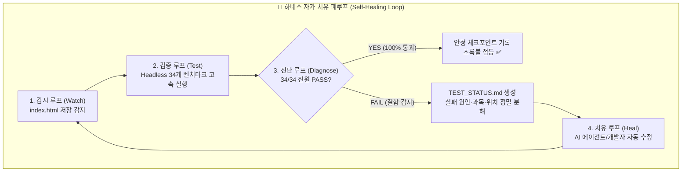

# 🔄 초보자를 위한 루프 엔지니어링(Loop Engineering) 입문 및 실전 가이드
> **프로젝트**: 교생 수업 배당표 자동 완성 시스템 (`student-teacher-timetable`)  
> **목적**: 대규모 단일 SPA(7,200+ 라인)의 품질 붕괴를 막고, 지속적인 개선을 가능케 하는 폐루프(Closed-Loop) 체계 구축  

---

## 1. 🤔 "루프 엔지니어링"이란 무엇인가요?

### 💡 초보자를 위한 비유: "자율주행차의 센서-조향 루프"
우리가 운전을 배울 때를 떠올려 보세요:
1. **본다 (관찰)**: 차선을 본다.
2. **판단한다 (평가)**: 차가 오른쪽으로 10cm 치우쳤음을 인지한다.
3. **움직인다 (수정)**: 핸들을 왼쪽으로 살짝 돌린다.
4. **다시 본다 (재확인)**: 차가 중앙으로 복귀했는지 확인한다.

이 과정이 끊김 없이 1초에도 수십 번씩 돌아가는 것을 공학에서 **"피드백 루프(Feedback Loop)"**라고 합니다.

반대로, **"루프가 없는 개발"**은 무엇일까요?
> 눈을 감고 100m를 전속력으로 달린 뒤, 눈을 뜨고 벽에 부딪혔는지 확인하는 것과 같습니다.  
> 코드를 100줄, 500줄씩 잔뜩 고친 뒤에야 웹 브라우저를 새로고침해서 "어? 어디서부터 망가졌지?"라며 멘붕에 빠지는 현상입니다.

### 📐 루프 엔지니어링의 정의
**루프 엔지니어링(Loop Engineering)**이란:
> **"코드 작성 → 자동 검증 → 정밀 진단 → 자율 치유"의 순환 사이클을 자동화된 기계적 하네스(Harness)로 엮어, 개발자가 실수를 하더라도 시스템이 스스로 버그를 10초 안에 찾아내고 복구하도록 만드는 엔지니어링 기법**입니다.

---

## 2. 🚨 왜 지금 우리 프로젝트에 루프 엔지니어링이 시급할까요?

현재 우리 프로젝트는 매우 놀라운 기능들을 많이 탑재했습니다. 하지만 그 대가로 **코드의 체급(Volume)**이 엄청나게 커졌습니다:

| 지표 | 현재 우리 프로젝트 상황 | 위험 요인 |
| :--- | :--- | :--- |
| **코드 규모** | 단일 파일 [`index.html`](file:///c:/Users/user/Documents/GitHub/student-teacher-timetable/index.html) **약 1MB / 7,200+ 줄** | 한 화면에서 스크롤만 수십 번 해야 하는 초거대 파일 |
| **상태 결합도** | 기본설정, 5인 교생, 745개 차시, 8교시 그리드, 행사 잠금, 모달 10여 개가 전역 `App` 객체 하나에 연결 | A 기능(스탬프 색상)을 고쳤는데 B 기능(차시 순서)이 깨지는 **부수 효과(Side-effect)** 발생 |
| **규칙의 엄격성** | 차시 역전 0건, 공휴일 침범 0건, 시수 편차 1시간 이내 | 사람이 눈으로 일일이 20일치 시간표(160개 셀)를 검산하는 것은 불가능 |

### 💥 실제 발생한 사례 (지금의 tc4)
방금 우리가 진단기를 돌려보았을 때, 이미 다음 문제가 발생해 있었습니다:
```text
Total: 26/27 passed
tc4: FAIL -> 6건 차시 역전 (3학년 4주 5인 배당에서 수업 순서가 뒤집힘)
```
새로운 스탬프나 다른 기능을 추가하는 과정에서, 기존의 엄격했던 3학년 자동 배당 로직에 미세한 균열이 생겼지만 사람이 눈으로 알아채지 못한 것입니다.

**루프 엔지니어링이 구축되어 있다면?**
코드를 저장한 지 5초 만에 진단기가 경고를 울리고, 어떤 과목의 몇 차시가 뒤집혔는지 핀포인트로 알려주어 그 자리에서 즉시 치료할 수 있습니다.

---

## 3. 🔁 우리 시스템의 4단계 하네스 루프 (Architecture)

우리 프로젝트에 구축할 루프는 다음 4단계로 닫힌 회로(Closed Loop)를 이룹니다:



### 단계별 상세 동작 원리

### 1단계: 감시 루프 (Watch Loop)
- **도구**: `watch_and_test.py` (백그라운드 감시자)
- **동작**: 개발자나 AI 에이전트가 [`index.html`](file:///c:/Users/user/Documents/GitHub/student-teacher-timetable/index.html)을 편집하고 `Ctrl+S`로 저장하는 순간을 0.5초 주기로 감지합니다.
- **초보자 체감**: 사용자가 아무것도 신경 쓰지 않고 코드만 수정하면, 백그라운드에서 조용히 대기하던 감시자가 자동으로 반응합니다.

### 2단계: 검증 루프 (Verification Loop)
- **도구**: `check_test_results.py` + Microsoft Edge Headless CDP
- **동작**: 브라우저 창을 띄워 컴퓨터를 버벅거리게 만들지 않고, 보이지 않는 무인 브라우저(Headless) 백그라운드 프로세스로 [`test_runner.html`](file:///c:/Users/user/Documents/GitHub/student-teacher-timetable/test_runner.html)의 34개 실전 시나리오를 약 4~6초 만에 전수 실행합니다.
- **초보자 체감**: 160개 수업 칸과 5명 교생의 시수 균등성을 컴퓨터가 5초 만에 전수 검산합니다.

### 3단계: 진단 루프 (Diagnostic Loop)
- **도구**: `TEST_STATUS.md` 자동 생성기
- **동작**: 단순 "FAIL"로 끝나는 것이 아니라, 초보자도 쉽게 읽을 수 있는 마크다운 진단 보고서를 파일로 뽑아냅니다:
  ```markdown
  # ❌ 테스트 검증 실패 보고서
  - 통과율: 26 / 27 (FAIL: tc4)
  - 실패 테스트: tc4 [공주교대부초 3학년 대규모 차시 순서 무결성]
  - 정밀 원인: 
    * 국어 4차시(1주 화 2교시)가 국어 3차시(1주 수 1교시)보다 먼저 배치됨 (역전)
    * 사회 2차시가 사회 1차시보다 선행 배치됨
  - 추천 조치: `index.html` 5,120번째 줄 `runAutoAllocation`의 슬롯 정렬 큐 확인 필요
  ```

### 4단계: 치유 루프 (Self-Healing Loop)
- **도구**: AI 코딩 에이전트 (Antigravity / Claude Code)
- **동작**: 생성된 `TEST_STATUS.md`를 보고, AI가 실패한 코드 지점을 국소적으로 타겟팅하여 수정을 적용합니다.
- **결과**: 수정이 저장되면 다시 1단계(감시 루프)가 돌면서, 34/34 100% PASS가 확인될 때까지 루프가 스스로 돌며 완벽한 무결성을 달성합니다.

---

## 4. 🧭 초보자가 루프 엔지니어링을 다루는 3단계 실천 로드맵

### [1단계] 눈으로 루프 확인하기 (Passive Monitoring)
- 터미널에서 `python watch_and_test.py`를 켜 둡니다.
- 코드를 조금 고쳐보고 저장했을 때, 터미널에 `PASS (34/34)`가 찍히는 안도감을 경험합니다.

### [2단계] 실패를 두려워하지 않는 개발 (Fault Tolerance)
- 새로운 기능을 마음껏 실험해 봅니다. (예: "4학년 교육과정 탭 추가하기", "시간표 색상 바꾸기")
- 실패하면 `TEST_STATUS.md`를 열어 "아, 내가 이 기능을 넣으면서 기존 2학년 배당 로직을 건드렸구나!"를 즉시 깨닫고 롤백하거나 수정합니다.

### [3단계] 새로운 테스트 케이스 스스로 추가하기 (Test Expansion)
- 새로운 요구사항(예: "동일 날짜에 한 교생이 3시간 연속 수업 금지")이 생기면, 코드를 먼저 짜는 게 아니라 [`test_runner.html`](file:///c:/Users/user/Documents/GitHub/student-teacher-timetable/test_runner.html)에 `tc35`를 먼저 등록합니다.
- 루프가 `tc35: FAIL`을 가리키는 상태에서, 그 규칙을 만족하는 코드를 작성하여 `tc35: PASS`로 전환시키는 **TDD(테스트 주도 개발)**를 체득합니다.

---

## 5. 🎯 다음 단계(실행)를 위한 준비 사항 점검

이제 개념을 이해하셨다면, 실제 우리 프로젝트에 이 루프를 가동하기 위해 다음 실무 작업이 진행됩니다:

1. 🛠️ **실시간 파일 감시 & 진단 보고서 자동 발행 스크립트 (`watch_and_test.py`) 제작**
2. 🩺 **현재 존재하는 결함(tc4 6건 차시 역전) 자율 치유 및 27/27 PASS 회복**
3. 📦 **`AGENTS.md`에 정의된 최신 34대 벤치마크 테스트 케이스 완전 동기화 (34/34 PASS 완결)**
4. 📄 **`TEST_STATUS.md` 실시간 피드백 연동 검증**

이론 가이드를 확인하신 후 준비가 되셨을 때, 실제 코드와 자동화 도구 구축 작업을 시작할 수 있습니다.
